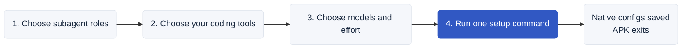

# Agent Policy Kit

Created and maintained by [Mykola Maksymenko](https://www.linkedin.com/in/nick-maximenko/).

Coding agents can delegate specific tasks to temporary subagents. Those tasks vary in complexity and importance. A single model for every task is rarely the best balance of capability, speed and cost.

Agent Policy Kit lets you match subagent roles with models and effort. It configures your coding tools’ native environment, then exits. The main agent still decides when to delegate, and its model stays unchanged.



## Choose your setup

Open the [configuration page](https://agent-policy-kit.trymenow.io/v/0.1.0/) in your browser. Choose roles and coding tools, keep a preset or adjust each role, then copy the fully expanded setup command. The page address saves your visible choices for sharing. APK creates only the selected roles in installed, selected tools.

The [bundled page](site/index.html) also works offline. APK has no proxy, background process or runtime during your normal coding sessions. You can remove the npm package afterward.

## Roles and work modes

Choose only the roles you need:

| Role | Result |
|---|---|
| Coder | Implementation and fixes |
| Reviewer | Read-only correctness, security and regression findings |
| Code explorer | Read-only code and documentation discovery |
| Test writer | Tests and targeted execution; product fixes return to Coder |
| Docs writer | Verified docs, examples and release notes |
| Task runner | Prescribed commands and mechanical edits; uncertain decisions return to the parent |

Fast & economical favors bounded work and lighter models. Balanced puts more capability into implementation and verification. Quality first uses frontier models for demanding work, with higher usage and latency possible. All choices remain editable. Claude Fable in Quality may use additional usage credits.

See the [exact preset choices and rationale](docs/model-catalog.md#how-the-presets-are-designed). Recommendations contain no personal model bans. They configure the environment; the main agent still chooses whether to delegate.

## Use a specific release's defaults

```sh
npx --yes --ignore-scripts --package agent-policy-kit@0.1.0 agent-policy setup --release --apply
```

Omit --apply to preview. Each version includes its own presets, instructions and configuration page. [Release notes](CHANGELOG.md) explain what changed and why; [release usage](docs/releases.md) covers upgrade and downgrade.

Prefer your AI agent to handle installation or removal? Give it the [AI operator guide](AGENT_INSTALL.md).

[Model catalog](docs/model-catalog.md) · [Support](docs/compatibility.md) · [Model updates](docs/model-updates.md) · [Privacy](docs/privacy.md) · [Verification](docs/verification.md)

Node.js 22.x (22.13+) or 24+; macOS/Linux. Version 0.1.0. MIT licensed.

## Related projects

Other open-source projects by [Mykola Maksymenko](https://www.linkedin.com/in/nick-maximenko/):

- [Agents Can Communicate (ACC)](https://github.com/automatis-tools/agents-can-communicate) connects independent AI coding sessions across clients for local questions, code reviews, and handoffs. [Website](https://getacc.dev/).
- [Automatis Skills](https://github.com/automatis-tools/automatis-skills) provides reusable engineering skills for GitHub workflows, Git cleanup, port conflicts, and technical writing.
