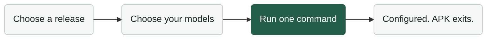

# Agent Policy Kit



**Your model choices. Your coding tools. One setup.**

APK configures Codex, Claude Code, Kimi and Antigravity through their native files, then exits. You can remove the npm package afterward.

**The main agent decides whether to use subagents.** Your preferences apply only when it delegates; the main model stays unchanged.

## Choose your setup

Open the [configuration page](site/index.html) in **Google Chrome**. Choose a preset in All, or select a tool to customize its models and effort. Copy the generated command and run it once. Only installed tools are configured.

The page is a self-contained HTML file: no backend or data upload. Before hosting, open site/index.html locally. See [page preview and hosting](docs/configuration-page.md).

## Use a specific release's defaults

After npm publication:

```sh
npx --yes --ignore-scripts --package agent-policy-kit@0.1.0 agent-policy setup --release --apply
```

Omit --apply to preview. Each version includes its own presets, instructions and configuration page. [Release notes](CHANGELOG.md) explain what changed and why; [release usage](docs/releases.md) covers upgrade and downgrade.

Prefer your AI agent to handle it? Give it the [setup and removal guide](AGENT_INSTALL.md).

[Model catalog](docs/model-catalog.md) · [Support](docs/compatibility.md) · [Model updates](docs/model-updates.md) · [Privacy](docs/privacy.md) · [Verification](docs/verification.md)

Node.js 22.x (22.13+) or 24+; macOS/Linux. Version 0.1.0 is a local release candidate. MIT licensed.
