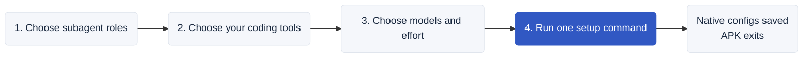

# Agent Policy Kit



**Configure your coding subagents once.**

APK sets up native subagent roles for Codex, Claude Code, Kimi and Antigravity. Choose the roles you need, their models and effort. One command configures your installed tools, then exits.

**The main agent decides whether to use subagents.** Your preferences apply only when it delegates; the main model stays unchanged.

## Choose your setup

Open the [configuration page](site/index.html) in **Google Chrome**. Choose roles and coding tools, keep a preset or adjust each role, then copy the fully expanded setup command. APK creates only the selected roles in installed, selected tools.

The page works offline. APK has no proxy, background process or runtime during your normal coding sessions. You can remove the npm package afterward.

## Use a specific release's defaults

After npm publication:

```sh
npx --yes --ignore-scripts --package agent-policy-kit@0.1.0 agent-policy setup --release --apply
```

Omit --apply to preview. Each version includes its own presets, instructions and configuration page. [Release notes](CHANGELOG.md) explain what changed and why; [release usage](docs/releases.md) covers upgrade and downgrade.

Prefer your AI agent to handle installation or removal? Give it the [AI operator guide](AGENT_INSTALL.md).

[Model catalog](docs/model-catalog.md) · [Support](docs/compatibility.md) · [Model updates](docs/model-updates.md) · [Privacy](docs/privacy.md) · [Verification](docs/verification.md)

Node.js 22.x (22.13+) or 24+; macOS/Linux. Version 0.1.0 is a local release candidate. MIT licensed.
