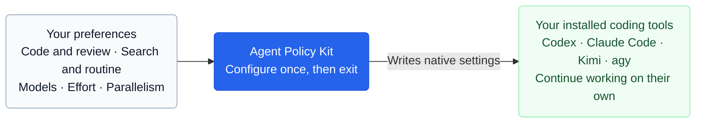

# Agent Policy Kit

**Set up your coding tools once. They run on their own.**

Agent Policy Kit is an npm configurator that applies a shared setup to the coding tools already on your computer.

**Your agent decides whether to use subagents.** These preferences apply only when it delegates.

Choose models for code and review, lighter models for search and routine work, and a parallelism target. The kit translates those choices into each tool's own settings and agent files.

After setup, it exits. **You can remove the npm package.** Your tools keep their configuration and use their usual accounts and providers.

## Let your AI agent handle setup

Share this repository with your coding agent:

> Follow the [AI setup and removal guide](AGENT_INSTALL.md). Configure my installed coding tools with the default preferences. Verify the saved settings and report any unsupported options.

Your agent handles detection, configuration and checks. Your main model and unrelated settings stay unchanged. Ask the same agent to remove the configuration later if needed.

[Support and limits](docs/compatibility.md) · [Examples](docs/use-cases.md) · [Keeping models current](docs/model-updates.md) · [Privacy](docs/privacy.md) · [Verified results](docs/verification.md)

Requires macOS or Linux and Node.js 22.x (22.13+) or 24+. Version 0.1.0 is a local release candidate; the guide covers local tarballs and npm releases.

MIT licensed. Independent of the client vendors.
