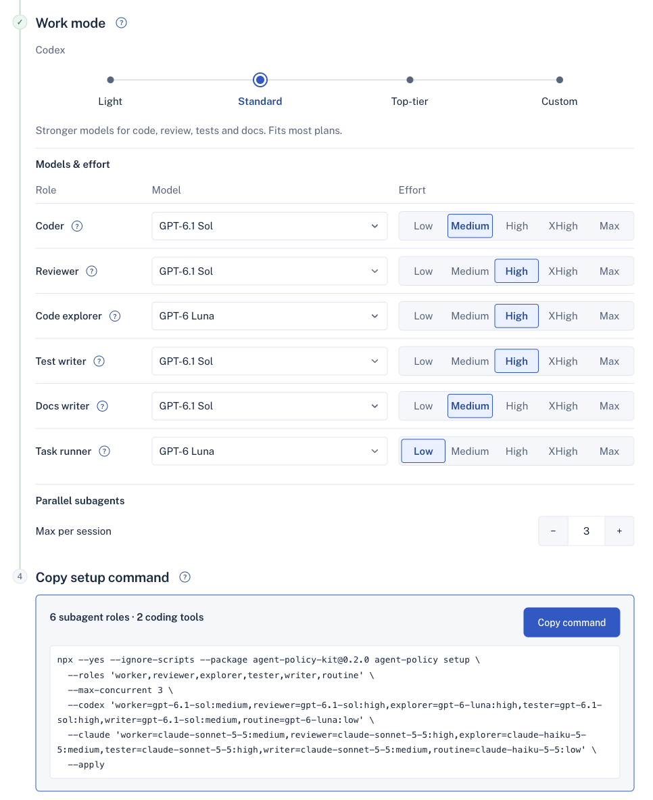

# Agent Policy Kit

Created and maintained by [Mykola Maksymenko](https://www.linkedin.com/in/nick-maximenko/).

**Stop subagents from burning your plan limits.** APK gives each subagent role a model that fits the task and your plan in Codex, Claude Code, Kimi, Antigravity and Grok Build. One command, then it exits.

My own Codex logs; tasks differed between the runs. [How it was measured](docs/limits-evidence.md).

## Set it up

1. Open the [configurator](https://agent-policy-kit.trymenow.io/). Pick roles, your coding tools and a mode: **Light**, **Standard** or **Top-tier**, by how much of your plan subagents may use.
2. Copy the command and run it. Remove the last `--apply` line to preview first; nothing is written without it.

## Good to know

- Your main agent and its model stay unchanged. It still decides when to delegate.
- No proxy and no background process. Delete the npm package after setup.
- `npx --yes --ignore-scripts --package agent-policy-kit@0.2.0 agent-policy show` reads your current settings. Use `uninstall --apply` instead of `show` to remove APK's settings and keep yours.

[Model catalog](docs/model-catalog.md) · [Release notes](CHANGELOG.md) · [AI operator guide](AGENT_INSTALL.md) · [Support](docs/compatibility.md) · [Privacy](docs/privacy.md)

## Related projects

- [Agents Can Communicate (ACC)](https://github.com/automatis-tools/agents-can-communicate): connect independent AI coding sessions for questions, reviews and handoffs.
- [Automatis Skills](https://github.com/automatis-tools/automatis-skills): reusable engineering skills for GitHub workflows, Git cleanup and technical writing.
