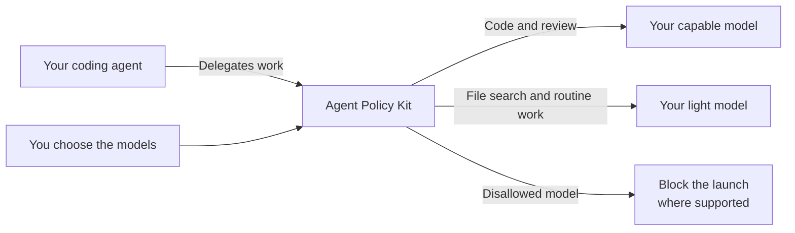

# Agent Policy Kit

**Choose which models do the work your AI delegates.**

Coding agents can delegate tasks to helpers called **subagents**. You may want a capable model to change code and review it, and a lighter model to find files or collect facts.

Agent Policy Kit applies those choices to supported subagent launches. Your main conversation keeps the model you chose.

## Why use it?

- **Match models to the job.** Choose models for coding, review and routine work. Rule out unwanted models.
- **Keep your choices consistent.** Maintain one set of rules across your installed coding tools.
- **Keep control of your setup.** Detect existing tools, preserve unrelated settings, and remove integrations when you choose.

Works with **Codex, Claude Code and Kimi**. [Support varies by tool](docs/compatibility.md); exact-model control for Antigravity (agy) is currently unsupported.

## Ask your agent to set it up

Share this repository with your coding agent and ask:

> Follow [AGENT_INSTALL.md](AGENT_INSTALL.md). Install Agent Policy Kit for the coding tools present on my computer. Use the balanced policy, verify what is active, and report anything unsupported.

Your agent handles setup and checks using your existing tools and accounts. For removal, ask it to follow the same guide.

Version 0.1.0 is a local release candidate. The guide covers local tarballs and npm releases.

## What to expect

Checks run locally and cover supported launches. Your provider controls model access, usage limits and billing. See [verified results](docs/verification.md) for what has actually been tested.

Requires macOS or Linux and Node.js 22.x (22.13+) or 24+.

[Examples](docs/use-cases.md) · [Support and limits](docs/compatibility.md) · [Privacy](docs/privacy.md) · [For contributors](docs/development.md) · [npm release](docs/npm-release.md)

MIT licensed. Independent of the client vendors.
