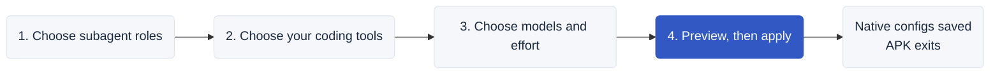

# Agent Policy Kit

Created and maintained by [Mykola Maksymenko](https://www.linkedin.com/in/nick-maximenko/).

Coding agents hand tasks to subagents, and those subagents draw on the same plan limits as your main session. When every subagent runs on a top model, limits run out fast. Agent Policy Kit (APK) gives each subagent role a model and effort that fit the task and your plan. It writes your coding tools' native settings, then exits. Your main agent and its model stay unchanged.


<sub>From my own Codex logs: two runs, each from a full weekly limit. Tasks differed between the runs, so this is one developer's experience, not a benchmark. [How it was measured](docs/limits-evidence.md).</sub>



## Configure in the browser

Open the [configurator](https://agent-policy-kit.trymenow.io/v/0.2.0/) and follow its four steps:

1. Choose subagent roles.
2. Choose your coding tools: Codex, Claude Code, Kimi, Antigravity or Grok Build.
3. Choose a work mode for each tool, or adjust any role's model and effort:
   - **Light**: light models for every role. Limits last longest; good for entry plans and many parallel sessions.
   - **Standard**: stronger models for code, review, tests and docs. Fits most plans.
   - **Top-tier**: high-end models for most roles. Uses limits fastest; for top plans.
4. Copy the setup command.

The page address keeps your choices, so you can share a setup as a link. The [bundled page](site/index.html) also works offline.

## Preview and apply in the terminal

The copied command ends with `--apply`. Remove that last line to preview the changes first:

```sh
# Preview: shows what each coding tool would get. Writes nothing.
npx --yes --ignore-scripts --package agent-policy-kit@0.2.0 agent-policy setup --release --preset balanced

# Apply: the same command plus --apply.
npx --yes --ignore-scripts --package agent-policy-kit@0.2.0 agent-policy setup --release --preset balanced --apply
```

Without the configurator, `--preset fast` selects Light, `balanced` Standard and `quality` Top-tier.

| Task | Command |
|---|---|
| Read your current subagent settings | `agent-policy show` |
| Preview removal | `agent-policy uninstall` |
| Remove APK's settings, keeping your own | `agent-policy uninstall --apply` |

Run them with the same `npx --yes --ignore-scripts --package agent-policy-kit@0.2.0` prefix. APK has no proxy or background process. You can delete the npm package after setup. Prefer your AI agent to do it? Give it the [AI operator guide](AGENT_INSTALL.md).

## Roles

| Role | Result |
|---|---|
| Coder | Implementation and fixes |
| Reviewer | Read-only correctness, security and regression findings |
| Code explorer | Read-only code and documentation discovery |
| Test writer | Tests and targeted execution |
| Docs writer | Verified docs, examples and release notes |
| Task runner | Prescribed commands and mechanical edits |

The main agent still decides when to delegate. Claude Fable may use additional usage credits on plans that do not include it.

[Model catalog](docs/model-catalog.md) · [Release notes](CHANGELOG.md) · [Releases](docs/releases.md) · [Support](docs/compatibility.md) · [Privacy](docs/privacy.md) · [Verification](docs/verification.md)

Node.js 22.x (22.13+) or 24+; macOS/Linux. Version 0.2.0. MIT licensed.

## Related projects

Other open-source projects by [Mykola Maksymenko](https://www.linkedin.com/in/nick-maximenko/):

- [Agents Can Communicate (ACC)](https://github.com/automatis-tools/agents-can-communicate) connects independent AI coding sessions across clients for local questions, code reviews, and handoffs. [Website](https://getacc.dev/).
- [Automatis Skills](https://github.com/automatis-tools/automatis-skills) provides reusable engineering skills for GitHub workflows, Git cleanup, port conflicts, and technical writing.
